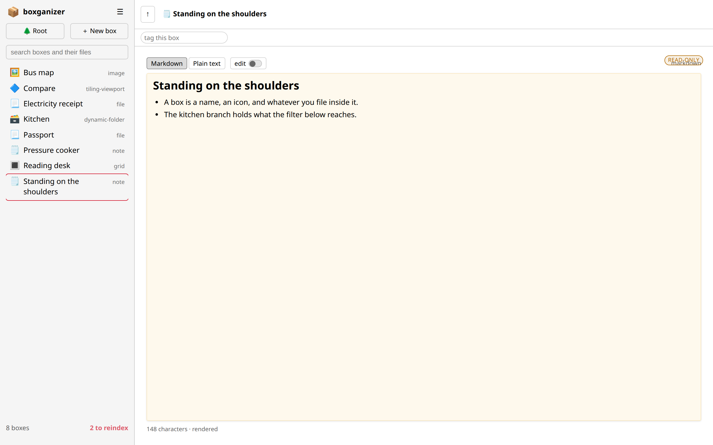
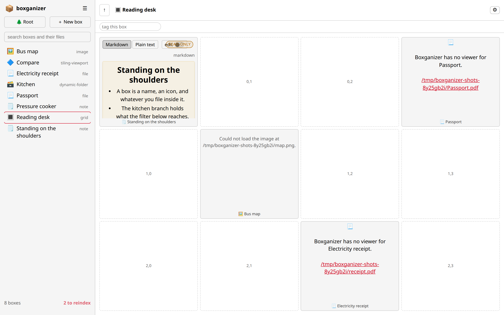
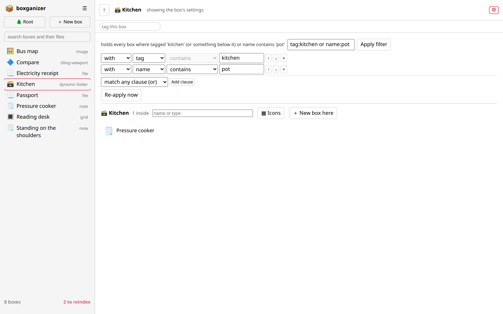
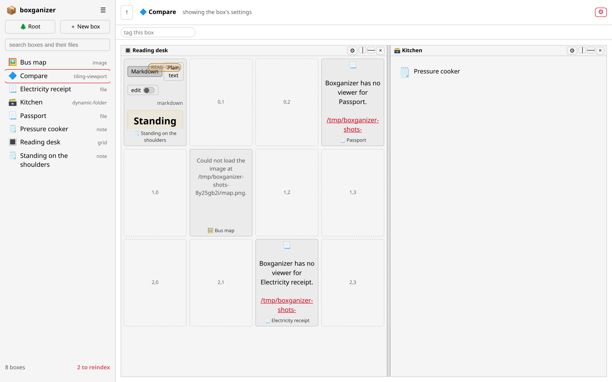

- *Warning*: 100% vibe-coded
- *Warning*: access to web app = shell with web server uid
- *Disclaimer*: Works-for-me^TM

# Boxganizer

Personal knowledge management where **everything is a box**.

A box is one thing you keep: a scanned passport, a photograph, a PDF, a note you typed, a
running boiler, a book you mean to read. Boxes hold other boxes too, so a folder, a project,
a list of things to do and a mindmap are all the same kind of thing wearing different clothes.
One SQLite file holds them all, and the same store answers to a command line, a terminal
window and a browser — which means nothing you file is locked inside the tool you happened to
be using.

What you end up with is a library you can do the four things a library has to support.

* **Capture** it however it arrives: a file dropped on the page becomes a box typed to match
  its contents, a note is a box, a photo is a box, a sensor reading is a box.
* **Organise** it without choosing one scheme: a box can sit in several parents at once, so
  `Passport` can be under `Trip to Lisbon` and under `Identity` without either owning it.
  Tags add a hierarchy on top, and grids, desktops, checklists and mindmaps arrange the same
  boxes visually.
* **Find** it again by what it is, what it is called, what it is tagged, or what its files
  say — full-text search reads inside text and PDF files and shows the passage that answered.
* **Keep it alive**: a dynamic folder holds whatever a saved filter matches, so a box you
  tagged an hour ago is already in the right folder; a sensor box redraws itself when the
  broker publishes.

Nothing here is a graph of pretty nodes you cannot query. Every box is a row, every link is a
row, and `box` will tell you both.

## Everything is a box

There are 44 types. They are not 44 unrelated features: they sit in one hierarchy with five
grouping levels, and 39 of them are the kinds you can put on a box. Two of the levels do
almost all the explaining.

**Some boxes hold a resource.** A `file`, `image`, `pdf`, `markdown`, `text`, `directory` or
`ssh` box points at one thing outside the library — a path, a URL, an address — and its whole
job is to show you that thing and keep its rules. A `pdf` box refuses a `.png`. A `web` box
insists on `http(s)`. Most resource boxes cannot contain other boxes — a picture holding a
folder is a lie about a picture — with one deliberate exception: a `directory` points at a
folder on disk *and* may hold boxes you file in it by hand, because that is the one place
where the two kinds of container genuinely overlap.

**Some boxes organise other boxes.** A `folder` holds whatever you put in it. A `cabinet`
holds every box in the library. A `dynamic-folder` holds whatever its filter matches and
refuses to have a box filed into it by hand, because the next re-list would take it back out
(ADR 25). A `grid`, `desktop`, `checklist` or `mindmap` also organises, but it organises
*spatially or structurally*: cell, coordinate, line, branch. A `viewport` organises your
attention rather than your boxes — it lends its space out and shows several boxes at once.

Everything else is a leaf that behaves like content: a `note` is words of boxganizer's own,
written to a plain markdown file beside the database (ADR 14) so your library stays readable
even if this program never ships again.

Two rules hold across all of it, and both are enforced by the store rather than by the screen:

* **Filing is many-to-one and never moves the box.** Dropping `Passport` into a second folder
  adds a link; the box is not copied, and `box show` lists every parent it has.
* **A tag's name is its identity, and its parents are never stored** (ADR 19). A box tagged
  `boiler` answers to `home` as well, because `boiler` hangs below it — which is why a tag
  you merely renamed can empty a dynamic folder the moment you rename it.

## Three ways in

All three read and write the same database, and none of them has a private feature the others
lack for long.

| Interface   | Command        | What it is for                                                     |
| ----------- | -------------- | ------------------------------------------------------------------ |
| CLI         | `box`          | scripts, muscle memory, and everything you want to do in a pipe    |
| Text UI     | `box tui`      | one screen over SSH: filter, list, detail                          |
| Web app     | `box serve`    | the whole library: content views, drag & drop, live sensors        |

**The CLI** is one word after `box` — `box add`, `box list`, `box show`, `box search`,
`box tag give`, `box link`, `box check`. Its reference is below, and it is the interface
everything else is obliged to agree with.

**The text UI** is one screen: a filter field, the list of boxes it narrows, and a detail
panel for whatever you select. `n` makes a box, `r` re-reads the store, `escape` clears the
filter, `q` leaves. That is the whole program. It is deliberately small — it is there for the
machine you have only a terminal on, and it does not try to draw a picture of a desktop in
characters.

**The web app** is where the library is legible: every type has a view, boxes are dragged
between each other, and what you see is the box's content rather than a table about it.

## The web app

`box serve` and open `http://127.0.0.1:8000`. One pane to find things, one pane to look at
the thing you found.



**Left: the library.** The root is pinned first, then every box, each with its icon and type.
The field above it searches by a box's own fields *and* by the words inside its text and PDF
files, shows the passage that answered, and says what your words were widened to. ☰ beside
the library name holds what belongs to the library rather than to one box: About, Check the
library, and the two index passes. Along the bottom, in front of the count, the index reports
itself permanently — `75 indexed`, or `2 out of date`, or `indexing…`.

**Right: one box, content first.** This note is being *read*, not edited: a note shows an
`edit` switch, and the sheet itself carries a small `read-only` / `editing` cue, so the note's
condition is legible from wherever your eye is rather than only from the toolbar. Both
settings live on the box. The toolbox writes markdown markers into your text and nothing else,
and a box can be named inside a sentence as `[📋 name](boxganizer:uuid)` — an ordinary markdown
link on a scheme that reaches nothing until this page decides that clicking it opens the box.



**A grid is rows and columns you set** — type the numbers or step them — with one child per
cell. Drag a box into a cell to place it; drop on an occupied cell and the two swap;
right-click a cell to make a box there. Nothing about the arrangement is decorative: the
placement is stored on the grid box, so it comes back. A `desktop` is the same idea with the
lines taken away (icons anywhere, a wallpaper if the box points at a picture, a magnetic grid
only if you ask for one), and a `checklist` is the same idea as a markdown list you can tick,
written out as plain `- [ ]` lines beside the database.



**A dynamic folder is a saved question.** The filter is one expression — `tag:kitchen or
name:pot` — and the rows above the list are an editor for it: one row per clause, add, remove,
reorder, negate, with the expression rewritten as you go and the two never able to disagree
(ADR 20). Membership is written into the links table, so `box show`, `box tree` and every box's
`in` list see a filtered folder exactly like one filled by hand. And because the folder is a
question, filing into it by hand is refused — the sentence in the screenshot's own corner tells
you to change the box instead — while a tag renamed three windows ago re-cuts it immediately.



**A viewport lends its space.** Opening a box from another box replaces it, which is right for
filing and useless for comparison; a viewport box is never replaced. Split a pane side by side
or above and below, drag the bar, close a pane and its sibling reclaims the room. Each pane
keeps its own path line — so `Panel › InCell › Deep` is clickable back — its own folded
settings row, and its own idea of where it is. Drop a box on a pane and it is *copied* there;
hold Shift and it *moves*, which is the only honest way to make one gesture mean two things
people can distinguish afterwards (ADR 23). The windowed kind floats windows instead of tiling
them: each can be minimized to its title, maximized over the board and restored to the exact
rectangle it had, and the pile's transparency is a slider that starts fully transparent and
keeps the window you last touched solid.

What every other type shows — images, PDFs, markdown, directories, mindmaps, MQTT and HTTP
sensors, VNC screens, SSH consoles, notes, checklists — is set out in
[doc/web-app.md](doc/web-app.md), along with the controls each view carries.

## Install

```bash
python -m venv .venv
source .venv/bin/activate
pip install -e ".[dev]"          # the program, plus the test and lint tooling
```

There is nothing else to choose. `pipx install boxganizer`, `uv tool install boxganizer` and a
plain `pip install boxganizer` all give you the CLI, the web app, the text UI and MQTT — every
interface is a normal dependency, not an option you have to know the name of (ADR 24). `dev` is
the only extra, and it is the tooling to work on boxganizer, not a feature of it.

If an interface's library is genuinely missing, the install is broken or older than this change,
and the program says so in the form your installer understands — a pipx install is told
`pipx install --force boxganizer`, a uv one `uv tool install --reinstall boxganizer`, a plain venv
`python -m pip install --force-reinstall boxganizer`. That advice is generated from the running
process rather than copied out of this file, because `box` is a console script in an isolated
environment and pip in the wrong Python installs it somewhere the tool will never look.

## The CLI

```bash
box init                                     # create the database: root + cabinet
box add "Kitchen" -d "Room for cooking" -m floor=0
box add "Passport" -i 🛂 -d "Expires 2031" --parent Kitchen
box add "Loose" --no-parent                    # keep it out of the tree
box edit Kitchen                               # edit the row as YAML in $EDITOR
box add "Report" -r report.pdf --infer         # take the type the resource suggests
box link "Passport" "Kitchen"                  # put a box inside another box
box unlink "Passport" "Kitchen"                # take it out again (the box stays)
box link "Kitchen" root                        # take the root's slot from cabinet
box ls                                         # same command as `box list`
box list
box show Kitchen
box search cooking                           # names, fields, and what the files say
box search "basement NOT pump"               # quotes and and/or/not are understood
box index                                    # read every text and PDF file again
box ssh Build "df -h"                          # one command on the machine an ssh box points at
box tree                                       # starts at the root box
box tree Kitchen                               # or wherever you say
box types                                      # the box type hierarchy
```

`box init` leaves two boxes behind: **root** (type `root`), the way in, and
**cabinet** (type `cabinet`) in the root's single child slot. New boxes get **no
parent** unless you pass `--parent NAME` — the root holds exactly one box, so
filing every new box there would keep evicting the previous one. Running `init`
again adds nothing.

The root's own page is one line — `root › 📂 That Box` — and then the box itself, at full size. The
name is the way in: click it to open the box as the subject of the page, right-click it for the box's
menu (where *Remove from root* still lives). Dragging a box onto the line takes the slot; dropping one
onto the child's own view belongs to the child, as it should. An empty root says so and offers nothing
else, because there is nothing to offer.

Every command is one word after `box`. `box link CHILD PARENT` files the box named
first inside the one named second, and `box ls` is `box list` said shorter.

`box search` looks in two places. First the box itself — name, description, resource,
metadata. Then, for boxes that hold a **text**, **markdown** or **PDF** file, inside
that file, and it answers with the words that matched:

```
$ box search basement
🔤 Pump log  [in the file: [Cellar] pump service log … The sump under the kitchen]
  searched: basement; also: basement -> cellar/vault
```

The second line is the point of the whole thing: the file never said "basement". Three
things widen a query, and all three are reported rather than done quietly —

| Widening | Where it comes from | Example |
| -------- | ------------------- | ------- |
| Stems | SQLite's porter tokenizer, at index time and again on the words you type | "paint" finds "painted" |
| Synonyms | a list in the code, plus your own `thesaurus.json` | "cellar" finds "basement" |
| Near-miss spellings | compared only against words your library already contains | "cellrr" finds "cellar" |

A name is never widened — a box called *Cellar Plans* should not turn up just because
you asked for a basement. Nothing outside the content confine is read (see
`BOXGANIZER_CONTENT_ROOT` below), files over 2 MB are left alone as are the last pages
of a PDF past page 200, and a scan with no text layer is reported as such.

`thesaurus.json` sits next to the database and is plain JSON, a list of lists or a
word-to-synonyms object, and is merged with the words that ship with Boxganizer:

```json
{"annex": ["outbuilding", "wing"], "soho": ["london office"]}
```

The index lives in the database while the files do not, so three ordinary things make
them disagree: a library copied to another machine, a database written before the index
existed, and a file edited outside Boxganizer.

```bash
box index                                    # read everything wanted again
box index --check                            # only look: which files changed since
box index --stale                            # read those alone
box index --add Ledger-csv                   # this file, whatever its type says
box index --drop Huge-log                    # and not this one
box check                                    # every box's resource: still there, still right
box check --fix-stale                        # and read again whatever has changed
```

`box check` is the one command that asks whether the library's promises still hold: is
each box's file where it said, of the kind the type expects, inside the content confine,
and up to date in the index? It also names the files Boxganizer wrote for boxes that no
longer exist (ADR 14 keeps them on purpose) and the notes that link to a box that is not
here. Every finding prints the command that repairs it, unwrapped so it can be copied, and
nothing is changed unless asked: a check that "helped" by guessing where a moved file went
is a tool that files your documents in the wrong places. The same findings, and the same
repairs as buttons, are the page's **Check the library** action.

The dialog changes with the type, because it is not asking the same question of a note, a
topic and a host. An address whose *path* means something shows an example while you type
(`mqtt://host:1883/boiler/pressure`), a type that genuinely needs a piece of metadata gets
a field for it and one that merely honours it gets a field marked *optional* — metadata a
type will use but never ask for is a feature that exists only in the documentation — and
Browse and the index tick disappear when the resource is not a file on this machine — a control that will be ignored is a control that lies about what it is
asking. A refusal is written **inside the dialog**, in its own line, because the status bar
behind an open modal is a message nobody receives. And none of these windows is on the page until it
is asked for: a dialog that needs a layout of its own still disappears when it is closed, because a
window that sits permanently at the bottom of the document is not a window, it is a leak.

A box is also **about** things, and that is what tags are for. Type a word into the tag field
under the top line — or a path like `home/kitchen/boiler`, which creates the branch — and the box
gets a coloured chip. A tag inherits the ones above it, so a box tagged `boiler` answers to
`kitchen` and `home` too; those chips are drawn dashed and without a cross, because removing one
means moving the tag in ☰ **Manage tags…**, not editing the box. Colours are derived from a tag's
place in the hierarchy — one hue per branch, lighter as it goes down — so the tree is visible
without reading it. ADR 19.

☰ **Manage tags…** is a tree, read as a tree (ADR 26): one row per tag — caret, swatch, name, how many
boxes carry it and how many answer to it counting the branches below — with the tags ordered
depth-first and indented by their real depth. A filter at the top keeps a match **and everything above
it**, so filtering does not flatten the tree. Rename and colour happen in place and commit when you
leave the field; there is no Save button to lose. Drag a tag onto another to move it under that one, or
into the space below the list to pull it out to the top level; a drop that would bury a tag inside its
own descendant is refused where it is attempted. Everything else about the selected tag is in the pane
beside it — its colour and "auto", what is above it, delete, and a list of boxes to give the tag to in
one go. `↑ ↓ → ← Enter/F2 Del Space /` are the keys, and Delete moves you to the button rather than
pressing it: a branch of the library is not one keystroke from gone. The rules are the server's and
unchanged — no endpoint was added for any of this.

```bash
box tag add home/kitchen/boiler        # a path creates the parents it names
box tag give Rates boiler
box ls --tag home                      # the branch too, not only the word
box tag ls                             # the tree, with what each tag holds
```

Right-clicking anywhere in a box's pane brings up that box's menu — including the empty part of
a folder, the strip below a short list, or a background. A view that means something particular
by the right-click keeps its own; highlighted text keeps the browser's menu, because that click
was for copy. The menu is also the only way to **delete** a box: it asks once, inside the menu, and
the question states what survives — the links from the box go, what was filed inside stays in the
library, and the words a note wrote for itself stay in their file (ADR 28, ADR 14). The root is
never offered, because there would be nowhere left to file anything.

Every box's own controls — a folder's search, a desktop's grid size, a note's format bar, a
sensor's address — live in a row that is **hidden until you ask**. A ⚙ at the right end of the
top line opens it, and the box's content gives up the room: the drawer pushes the pane down
rather than lying over it. A box with no controls shows no gear, because a control with nothing
to control is decoration. The choice is remembered in the browser, not in the library: it is
about how you like to work, and a library should not change shape because you opened a folder
once.

A note or checklist you save is re-read into the search index **by the save itself** — no index
pass, no button: a word you just typed answers a search, and a word you deleted stops answering.

What is indexed is decided per **resource**, not per box, and the dialog says so as you
fill it in — a tick box, with the reason beside it:

> ☑ Index content
> *a file whose ending says words*

The default comes from the core (a text or PDF box, or a local file whose ending says
words: yes; a picture, a web page, an MQTT topic: no), and the tick is yours to
overrule. `box show NAME` then tells you where the index stands — in it since when,
`CHANGED since it was indexed`, or `left out of the search` — which is the difference
between a box that is not in the results and a search that is not working.

Two boxes pointing at one file share one resource row, so the file is read, hashed and
watched once, and `box search` offers both boxes with the same passage. The address is
normalised before it is compared, so `/a/../a.txt`, `./a.txt` written from `/a` and
`file:///a/a.txt` are one thing. Deleting a box lets its resource go; the row and its
indexed text are dropped only when nothing points at the file any more — and the file
itself is nobody's to delete.

`box edit` writes the whole row to a temporary YAML file, opens `$EDITOR` (or
`--editor "nano"`), then reads it back and saves. `metadata` and `config` are
stored as JSON and shown as YAML; `id` and the timestamps are shown but refused
if changed; links are edited with `box link`, not here. Quitting without saving
changes nothing.

Every box declares a type — `box add -t markdown`, `-t mqtt`, `-t mindmap` —
out of a hierarchy of 44 types — 5 grouping levels and 39 you can put on a box — documented
in [doc/box-types.md](doc/box-types.md#the-hierarchy).

```bash
box serve --port 8000                        # UI on /, API on /api, docs on /docs
box tui                                      # browse, filter (type), drill in (enter), new (n)
```


## Layout

```
src/boxganizer/
├── models.py      # the Box type and its name rules
├── store.py       # SQLite persistence, the only module that speaks SQL
├── boxtypes/      # the type hierarchy and its rules (see doc/box-types.md)
├── editing.py     # a box row as YAML and back, for `box edit`
├── bootstrap.py   # the two boxes every library starts with
├── config.py      # where the database lives
├── errors.py      # one exception hierarchy for all frontends
├── cli/           # the `box` command line, including serve and tui
├── web/           # FastAPI app, JSON API + HTML page, uvicorn runner
└── tui/           # Textual terminal browser
tests/             # pytest suites, one per layer
doc/               # architecture, development guide, ADRs
```

Frontends never touch the database directly and never import each other. All
logic lives in the core, which is why the three interfaces behave identically.

## Develop

```bash
make install      # create .venv and install the project with dev extras
make test         # pytest with coverage
make lint         # ruff check
make format       # ruff format
make typecheck    # mypy
make check        # lint + typecheck + test
make run-cli          # box <args>, e.g. make run-cli ARGS="box list"
make run-web          # box serve
make run-tui          # box tui
```

## Status

Early development. The core store (boxes, links, search), the box type registry
with its validation, the CLI, the web API with a minimal HTML browser, and the
text UI all work and are covered by tests.

The page opens on the **root box**, not on whatever the list happens to start with:
the root is asked of the server (`GET /api/root`), which finds it by its type
however it is named. The left panel is one page of the library sorted by name, so
digging for the root there lands on the first alphabetical box once the library
outgrows the page. A library with no root box says so and points at `box init`.

The root box is never an icon of what is filed in it: it shows that box the way
opening it would, toolbars and all, and one box at a time — dropping another takes
the slot, and the box it displaces stays in the library. Dropping something on a
view that already caught the drop (an icon onto a desktop, a box into a folder) is
not the root's to answer.

In the web app these kinds render as themselves: image, text, markdown, pdf,
video, archive, file, folder, dynamic-folder, cabinet, directory, grid, desktop,
mindmap, ssh, root, web, browser and mqtt. The rest still show their icon and their
detail panel.

A **dynamic folder** holds whatever a filter over all the boxes selects, and the
filter lives in the box's own `config.filter` as one expression — `type`, `name`, `tag`,
`content` and `resource`, each plain text or a regular expression, combined with `and`, `or`
and `not`: `type:note and tag:home and not name:"weekly log"`. The filter bar edits that same
expression, one row per clause; `box edit` and a raw config write edit the text directly. Membership is written into the links
table rather than computed on read, so `box show`, `box tree` and every box's `in`
list see a dynamic container exactly as they see one filled by hand. The store
keeps it true: a box created joins the folders that want it, a box renamed or
retyped leaves the ones it no longer fits, and editing the filter re-cuts the whole
membership — through the page, `box edit` or a raw config write, since all three go
through the same door. **A tag moving re-cuts the folders that ask about tags**: renaming
`home` to `house`, hanging `tools` underneath it or deleting a tag re-lists every folder whose
filter reads the tag tree, in the same breath, so a folder open on screen stops showing a box it
stopped holding. A dynamic folder will not accept a box filed into it by hand (ADR 25): the
re-list would take it back out, so `box link`, the API and a drag and drop all refuse, and the
sentence says what to do instead — change the box, or use an ordinary folder. Its "＋ New box
here" button is disabled for the same reason. The cabinet is the exception that proves the rule:
its filter selects everything, so a hand-filed box never leaves, and it keeps the button.
A filter that cannot be read selects **nothing** and says
why; reading it as "empty" would mean the whole library.

The **cabinet** is the dynamic folder that filters nothing: it holds every box, and
a cabinet is a box, so it holds itself. The root is the one exception — nothing
files the root, which is what keeps the way in open.

Most box types are **declared, not built**: they enforce their rules, but do not
fetch, index or talk to anything outside the machine — that is what the `planned`
line of each type describes. MQTT is the first that does, and only while a page
shows the box: a subscription nobody is watching is still `planned`, as is keeping
a value across a restart. Also not built: import/export, authentication, and
multi-user access.

See [doc/architecture.md](doc/architecture.md) for the design and
[doc/development.md](doc/development.md) for the workflow.

## License

GPLv2 — see [LICENSE](LICENSE).
